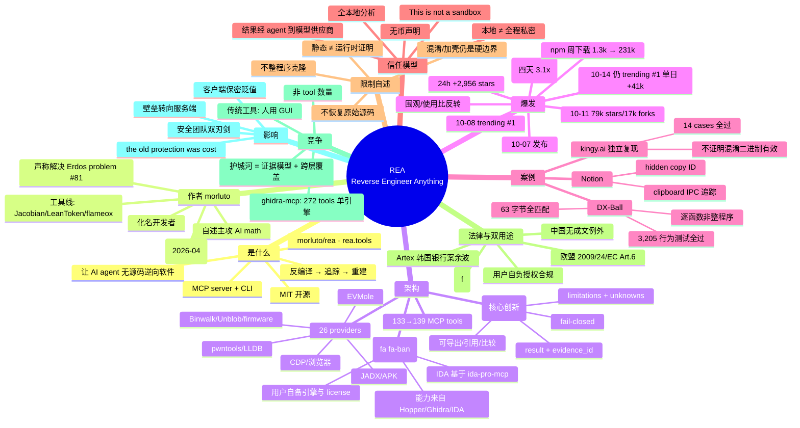

# REA（Reverse Engineer Anything）深度技术调研

> **一句话**：REA 不是反编译器，而是"反编译器的 agent 化编排层"——一个 MCP server + CLI，让 AI coding agent 无需源代码即可检查软件、解释功能实现并给出证据，然后帮你在自己的项目里重建该功能。
>
> - 原项目：[morluto/rea](https://github.com/morluto/rea)（MIT）· 官网 [rea.tools](https://rea.tools/)
> - 调研时间：2026-10-11 · 标注说明：= 来自 repo README / releases / 官方文档 / rea.tools；= 媒体、博客、YouTube 等二手来源
> - 本报告为独立第三方调研，与原项目无关
>
> 交互版本：
> - 📄 [report.html](./report.html)——完整交互调研页面（可直接浏览器打开）
> - 🗺️ [mindmap.html](./mindmap.html)——可交互折叠思维导图

## 2026-10-15 增量更新

- **热度继续加速**：10-11 为 79,124 stars / 17,066 forks，10-15 已达 **247,148 stars / 61,957 forks**——四天 3.1 倍；10-14 依然 GitHub trending #1，**单日 +41,187 stars**（10-08 登顶时单日 +7,744）。🟢
- **"围观/使用比"反转**：npm 包 `rea-agents` 周下载从约 1.3k 涨到 **231,579**——star 曲线和真实安装曲线对上了，不再是纯围观。🟢
- **发版节奏**：6.3.0（10-09，一批 BREAKING CHANGES 收紧证据契约）→ 6.4.0（10-11，Android ADB 真机检查、JEB MCP、Apktool）→ 6.5.0（10-14，JS 源码精确选择、code-split 跨包恢复、Evidence 摘要浏览）；PR 已排到 #3833，813 open issues。🟢
- **社区实测**：YouTube 有人用 REA 逆向 Obsidian——4 分钟重建 quick switcher 排序逻辑，4,915 次查询逐条验证与原版一致；但当要求列出"App 背后能做什么"时，Claude 的安全分类器中途叫停了写入。🟡
- **谱系定位**：agentbreaking 做了横向对比——GhidraMCP（11k stars）、ida-pro-mcp（12.6k）2025 年 3 月就已实现"agent 接反编译器"，REA 赢的不是首创，而是广度+打包+证据契约。🟡

## TL;DR（5 条硬发现）

1. **REA 自己不做反编译**——原生能力 100% 来自用户自备的 Hopper / Ghidra / IDA（IDA 侧基于开源 ida-pro-mcp）。它真正的新东西是**统一的证据契约**（result + evidence_id + limitations/unknowns，可导出、引用、比较）与**跨层追踪**（Electron renderer → IPC → main → native addon 一条链走完）。
2. **DX-Ball 的 3,205 / 63 是逐函数验证，不是整程序克隆**：1996 年游戏的单个函数经"反编译缺口 → 指令补全 → 常量读取 → C 重写 → VC4.0 重编"达到字节一致，33/55 个函数字节匹配——证明方法有效，也划定了边界（未混淆目标、单函数粒度）。
3. **"This is not a sandbox" 是白纸黑字的信任模型**：分析全本地、二进制不上传，但 SECURITY.md 明确它不防同用户恶意进程；且工具结果经 agent 流向模型供应商——**本地分析 ≠ 全程私密**，这是企业采用前必须过的合规项。
4. **爆发速度与"围观/使用比"反转**：repo 4 月创建（前身 betterBinaryMCP），10-07 发布后 24h +2,956 stars、10-08 登顶 trending #1、10-11 达 79,124 stars / 17,066 forks；**10-15 已达 247,148 stars / 61,957 forks（四天 3.1 倍），10-14 仍居 trending #1（单日 +41,187）**。npm 周下载从约 1.3k 涨到 **231,579**——star 曲线和真实安装曲线对上了。
5. **它出生在 Artex 银行入侵案的舆论余波里**：2026-10-06/07 韩国 7 家金融机构被 AI agent 攻陷（约 68,000 人数据泄露）→ 10-07 REA 5.0.0 发布 → 10-08 登顶 trending。REA 自身立场是"lawful research + 用户自负授权"，但事件说明"agent × 开源工具"降低攻击门槛已是进行时——这正是它"the old protection was cost"论点最锋利、也最具争议的注脚。

## 1. 项目基础

- **是什么**："One MCP for reverse engineering across binaries, applications, and runtime behavior." MCP server + CLI，工作流：反编译恢复可读代码 → 追踪执行直到功能被解释 → 在用户自己的技术栈里重建逻辑。
- **维护者 morluto**：化名开发者。自述主攻 "AI math"，声称与合作者 N0zoM1z0 解决了 33 年未解的 Erdos problem #81；同一作者的 "for agents" 工具线还有 Jacobian（agent 纯数学）、LeanToken（agent 代码智能）、flameox（runtime tracing）。真实身份未知。
- **起源**：repo 创建于 2026-04-14，最初叫 **betterBinaryMCP**——一个增强版 Hopper 反汇编器的 MCP server，后扩展为通用 RE 平台。
- **License**：MIT。
- **rea.tools**：一键安装引导、"什么是逆向工程"科普、两个可交互示例（Chrome 恐龙游戏速度规则；Windows 计算器 % 按钮的真实汇编与常量对照）、目标类型入口、博客与 showcases。

## 2. 架构

**工作原理（decompile → trace → recreate）**：agent 通过 MCP 调用 REA 检查目标、追踪相关代码 → REA 返回带证据的发现 → agent 基于证据追问、解释行为，或编写并测试自己的实现。CLI 使用完全相同的工作流。

**证据 + 明确局限的输出模型**（核心创新）：
- 每个工具结果返回 `result` + `evidence_id` + 完整 evidence 记录；结果内含 limitations 与 unknowns，而非简单 verdict。
- Evidence 可导出/导入为 session bundle；`compare_functions` / `compare_artifacts` 可直接消费 evidence 做版本 diff；部分工具可引用早先 finding 的 ID 而不重跑分析。
- 诚实性细节：合同明写 "REA does not fabricate percentages"；文件完整性默认 fail-closed——字节与声明 hash 矛盾则停止分析。

**工具规模**：官方安装文档确认 v5.0.0（2026-10-07）含 **133 个 MCP tools**；后期版本约 139 tools / 94 CLI commands / 26 providers。

**分析后端（providers）**：Hopper / Ghidra / IDA 为可互换的 native providers——REA 不重写反编译器，"rides an existing install"，用户自备引擎与 license。另有 JADX（APK）、Binwalk/Unblob（firmware）、pwntools、Chrome DevTools Protocol、mitmproxy/HAR、Apktool、ADB、JEB、LLDB、EVMole 等。

**支持的目标**：native binaries、JavaScript/Electron（ASAR 感知，静态分析不运行应用）、websites、.NET assemblies（纯静态，无需引擎）、Android APKs、Android 真机（ADB）、firmware、ZIP/APK/IPA/ASAR 包解剖、进程行为观测等。

## 3. 增长时间线

| 版本 | 日期 | 要点 |
|---|---|---|
| 4.0.0 | 2026-10-05 | native inspection primitives、DOS MZ 分析 |
| 4.1.0 | 2026-10-06 | headless JADX（APK）、Binwalk/Unblob（firmware）、IDA 只读支持 |
| 5.0.0 | 2026-10-07 | 133 MCP tools，正式发布 |
| 6.0.0 | 2026-10-08 | EVM、离线 ELF、LLDB 观测、Windows PE via Ghidra |
| 6.3.0 | 2026-10-09 | 一批 BREAKING CHANGES：证据契约收紧（capture/browser/process/contracts 各维度必填） |
| 6.4.0 | 2026-10-11 | ADB 设备检查、JEB MCP、Apktool |
| 6.5.0 | 2026-10-14 | JS 源码精确选择、code-split 跨包恢复、Evidence 摘要浏览 |

- 10-07：发布，24h 内 +2,956 stars；10-08 登顶 GitHub trending #1；10-11：**79,124 stars / 17,066 forks**；Hacker News 720 points / 311 comments。
- 10-14：**仍居 trending #1，单日 +41,187 stars**；10-15：**247,148 stars / 61,957 forks**（四天 3.1 倍）。
- 传播推手：Matthew Berman 10-08 发 thread 称 "Software is done"（他是使用者/推广者**不是**作者）。
- npm 周下载从约 1.3k 涨到 **231,579**——"围观远大于使用"已反转。

## 4. 展示案例

**DX-Ball**（1996 年 Windows 游戏）：声音声像函数 `0x406400`——反编译器首视图只有 `FUN_00406400(void)`（不完整）→ agent 下钻指令发现栈输入 → 追踪调用者得输入语义 `20 + 30 × tile_x` → 解出浮点常量 → 恢复公式 `pan = ((double)x * 1.5625 - 500.0) * dxball_pan_scale` → **3,205 个行为测试全过** → VC4.0 重编后**全部 63 字节**与原函数一致。项目整体 33/55 个函数字节匹配。**意义**：完整闭环实证；**局限**：逐函数粒度、目标未混淆、工具链可复刻。

**Notion**（Electron clipboard bridge）：追踪 `notion:clipboard:write` 从 preload 经 IPC 到主进程；发现 "hidden copy ID"——Notion 在复制的 HTML 里藏 `<!-- notionvc: <copy-id> -->` 注释，本地按该 ID 存结构化 block 数据。展示跨进程边界追踪能力；页面标注代码为简化改写。

**kingy.ai 独立复现**：2026-10-08 用 REA 6.0.0 复现 CSV 导出案例，14 个测试全过；结论明确 "does not establish accuracy on opaque binaries or demonstrate a complete application clone"。

## 5. 信任与安全模型

- **本地分析**：README FAQ —— "REA analyzes targets locally." 二进制不离开本机。但重要补充：工具结果会交给 agent，agent 再发给模型供应商——分析专有二进制前需选数据政策合适的模型。
- **"This is not a sandbox"**：SECURITY.md 原文——不防同用户恶意进程；Ghidra 的隔离措施"do not make Ghidra a sandbox"。REA 自身不要求授权确认，真正把关的是 agent 自己的 tool approval。
- **无币声明**："We have not issued or endorsed any cryptocurrency or token."（爆款项目防诈骗标配。）
- **已知坑**：Node 仅支持 22.19+/24.11+/26+（23/25 不支持）；输出极沉——实测 1,648 字节源码 → ~907KB JSON evidence；Ghidra 首次查询 330s vs MCP client 60s 超时。

## 6. 项目自述的限制

- 不恢复原始源代码、不整包克隆——返回的是伪代码/汇编/模块关系等**证据**，由 agent 再写实现。
- 每个结论附带证据与 caveats；静态分析 ≠ 运行时证明。
- 混淆/加壳/对抗分析技术、动态行为、冷门架构都会让重建更难；Windows 原生支持仍窄于 Linux/macOS。"anything" 是抱负而非现状。

## 7. 法律与双重用途

**韩国银行事件**：2026 年 10 月初，中国开源 AI agent **Artex AI** 被用于攻击至少 7 家韩国金融机构，约 68,000 人信息泄露（WSJ 报道）。事件曝光约 10-06/07，REA 5.0.0 恰于 10-07 发布——两者无直接关联，但共享"agent 降低攻击门槛"叙事。

**逆向工程的法律地位**（简述）：
- **美国**：DMCA §1201(f) 为互操作目的的反编译提供例外；Sega v. Accolade、Sony v. Connectix 判例支持。但许可中的反 RE 条款可能有效。
- **欧盟**：2009/24/EC 第 6 条——仅为互操作所必需时允许反编译，且合同不得架空该例外。
- **中国**：无成文对等例外，主要受《著作权法》《反不正当竞争法》与许可合同约束；学习研究、互操作分析一般被容忍。

**REA 自身立场**："REA provides tools for lawful reverse-engineering research, analysis, and reconstruction. **You are responsible for obtaining any required authorization and complying with applicable laws.**"

## 8. 竞争格局

| 维度 | REA | bethington/ghidra-mcp | 传统 RE 工具 |
|---|---|---|---|
| 工具规模 | 133→139 MCP tools | 272 MCP tools（v6.0.0） | N/A（人用 GUI） |
| 引擎 | Hopper/Ghidra/IDA 可互换 + 26 providers | 单引擎（Ghidra） | 各自为战 |
| 输出 | evidence bundle（provenance/confidence/limitations） | 工具返回为主 | 人读伪代码 |
| 许可 | MIT 全免费 | 开源 | Ghidra 免费；IDA/Hopper 商业 |

**什么是真正新的 vs "MCP wrapper"**：仅是 wrapper 的部分是原生反编译能力（100% 来自既有引擎）；真正新的是 (1) 统一抽象——多引擎 + 二十余种 providers 置于同一套工具/证据接口后；(2) 证据契约——为 agent 推理设计的输出形状；(3) 工作流产品化——一键 setup、`rea doctor`、snapshot 复用。工具数本身不是壁垒（ghidra-mcp 单引擎就有 272 个 tool）。

## 9. 为什么重要

- **"The old protection was cost"**：逆向过去需要专家在反汇编器里坐几小时；REA 把"定位功能 → 读懂逻辑 → 重建实现"变成 agent 可执行的分钟级循环。
- **仍保护软件厂商的东西**：混淆/加壳/反调试、服务端逻辑（agent 够不到服务器）、SaaS 化、license 条款、持续交付让二进制快速过期。且 REA 的重建是**逐功能**的，复杂系统的整体行为重建仍是巨大工程。
- **对闭源商业模式的影响**：客户端功能逻辑的"隐性保密"贬值——任何 shipped binary 的功能都可被 agent 读懂并仿制；壁垒转向服务端、网络效应、品牌与执行速度。短期最受冲击的是"小而美的客户端功能创新"。
- **对安全团队**：双刃剑——防守方可快速理解可疑样本/供应链组件；攻击方获得低成本侦察能力。分析不可信目标时请用隔离 VM + 本地模型。

## 10. 生态

- **安装**：`npx rea-agents setup`（推荐）/ `npm install --global rea-agents` / `rea doctor` 诊断全部注册与引擎。
- **支持 14 种 agents**：Claude Code、Claude Desktop、Codex、Cursor、Gemini CLI、Windsurf、Devin、OpenCode、GitHub Copilot CLI 等。
- **文档**：19 种语言 README（含简中）；网站 guides 覆盖 setup、native/application/browser/Android/firmware/EVM 全链路；Discord 社区 + GitHub Q&A。
- **社区实测**（2026-10-15 新增）：YouTube 有 Obsidian quick switcher 重建实测（4 分钟、4,915 查询验证）；agentbreaking 做了与 GhidraMCP / ida-pro-mcp 的谱系对比，结论是 REA 赢在广度+打包+证据契约而非首创。🟡

## 思维导图

> 交互版：[mindmap.html](./mindmap.html)

## 来源

**Primary（repo / 官方文档 / 官网）**：
- https://github.com/morluto/rea（README，2026-10-11 读取）
- https://github.com/morluto/rea/releases（release 历史）
- https://github.com/morluto/rea/blob/HEAD/SECURITY.md
- https://github.com/morluto/rea/blob/HEAD/docs/installation.md
- https://rea.tools/ · https://rea.tools/showcase/dx-ball/ · https://rea.tools/showcase/notion/
- https://github.com/morluto/morluto/blob/HEAD/README.md（作者自述）

**Secondary（媒体 / 博客 / 视频）**：
- https://startupfortune.com/an-ai-agent-that-reverse-engineers-any-software-just-hit-number-one-on-github/
- https://dev.to/itxtayab/an-agent-that-reverse-engineers-by-guessing-is-worse-than-useless-52bg
- https://www.devpik.com/open-source/rea
- https://kingy.ai/blog/reverse-engineer-anything-ai-rea-guide/
- https://runtimewire.com/article/matthew-berman-rea-ai-reverse-engineering
- https://bitcoinversus.tech/2026/10/09/rea-reverse-engineer-anything-ai-agents-ghidra-hopper-mcp/
- https://github.com/bethington/ghidra-mcp/releases（272 tools 核验）
- WSJ 韩国银行 Artex 事件报道

## 未验证 / 待核实项

- "~97 CLI commands"：公开文本中未找到精确对应（secondary 称 94），标为未验证。
- "150MB app → 577MB JSON"：出自 YouTube 章节，无文本出处；但"输出沉重"有 kingy.ai 实证（1,648B → 907KB）佐证现象存在。
- ghidra-mcp "215 tools"：实测其 releases 页为 251/272，早期数字可能过时。
- 中国法域 RE 法律 landscape：本次仅作通识背景，未深挖一手来源。
- star 数为快照（初版 2026-10-11，10-15 增量更新），持续快速变化中。

## 调研方法

1. 确认项目身份（morluto/rea）→ 2. 通读 README / releases / SECURITY.md / 安装文档 → 3. 核验 rea.tools 官网与 showcase 案例 → 4. 交叉核对二手报道（star 数、事件时间线）→ 5. 区分 primary / secondary 来源并标注未验证项。
只记录可验证的事实；数字精确到日期；争议点保留多方信源。
